<div align="center">

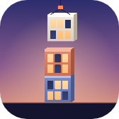

# Plumbline

**Doğru anı bekle, kuleni dik.**

<br>

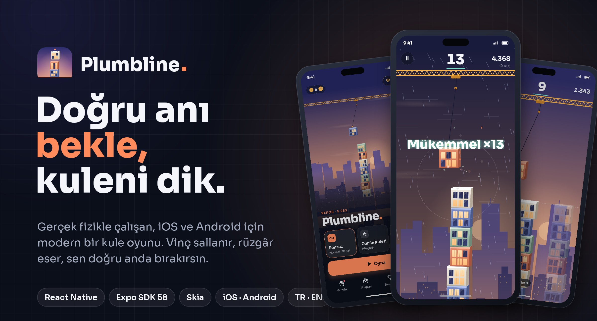

<br>
<br>

Vinçte sallanan katı doğru anda bırakıp kuleni yükselttiğin, gerçek fizikle çalışan,<br>
iOS ve Android için modern bir kule oyunu.

<br>


**[Ekranlar](#ekranlar)** &nbsp;·&nbsp; **[Fizik](#fizik)** &nbsp;·&nbsp; **[Mimari](#mimari)** &nbsp;·&nbsp; **[Gizlilik](#güvenlik-ve-gizlilik)** &nbsp;·&nbsp; **[Yol haritası](#yol-haritası)**

</div>

<br>

<table>
  <tr>
    <td width="50%" valign="top">
      <h4>🏗️&nbsp; Gerçek fizik</h4>
      Sarkaç, momentum, ağırlık merkezi ve esneyen bir kule. Kat düz oturur, kenarı aşarsa devrilir.
    </td>
    <td width="50%" valign="top">
      <h4>🌦️&nbsp; Her oyun başka bir gökyüzü</h4>
      Rüzgâr, fırtına ve sis fiziği etkiler; zorlaştıkça puan çarpanı artar.
    </td>
  </tr>
  <tr>
    <td width="50%" valign="top">
      <h4>👻&nbsp; Rekorunla yarış</h4>
      Hayalet modunda en iyi oyunun aynı anda yanında yeniden oynanır. Günün Kulesi herkes için aynı.
    </td>
    <td width="50%" valign="top">
      <h4>🔒&nbsp; Cihazında, şifreli</h4>
      Hesap ya da sunucu yok. Kayıtlar AES-256 ile şifreli, anahtar Keychain / Keystore'da.
    </td>
  </tr>
</table>

<br>

## Ekranlar

<p align="center">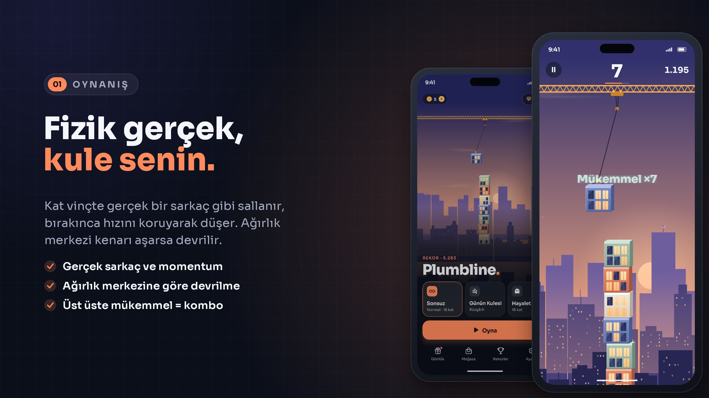</p>
<p align="center">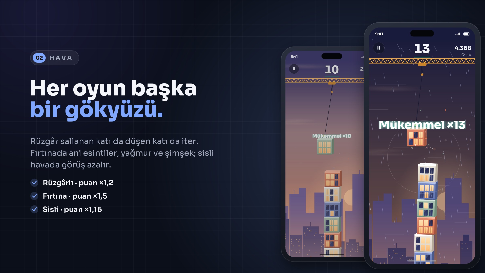</p>
<p align="center">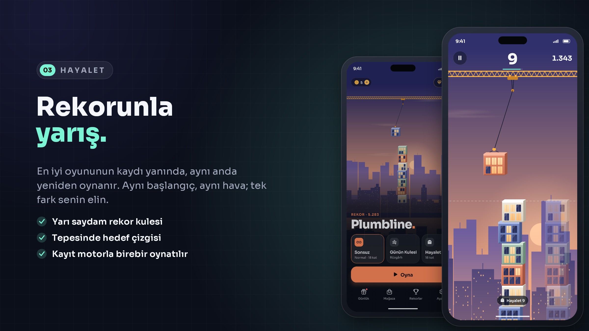</p>
<p align="center">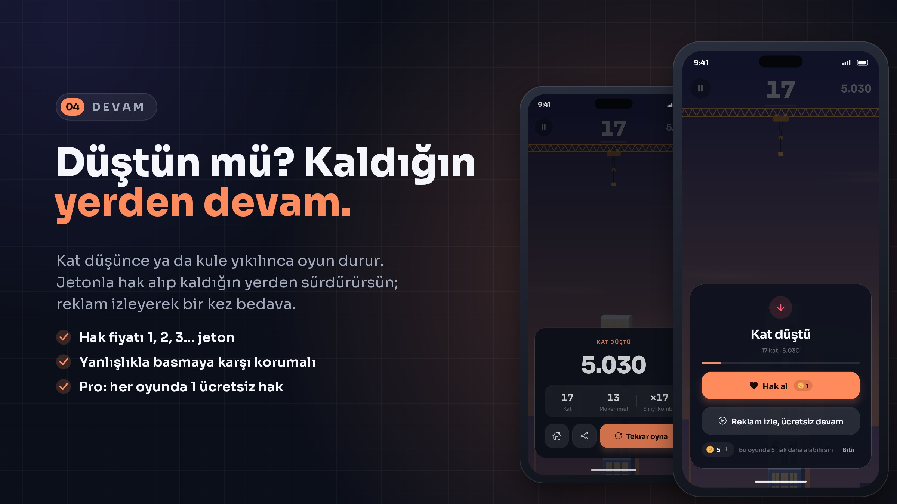</p>
<p align="center">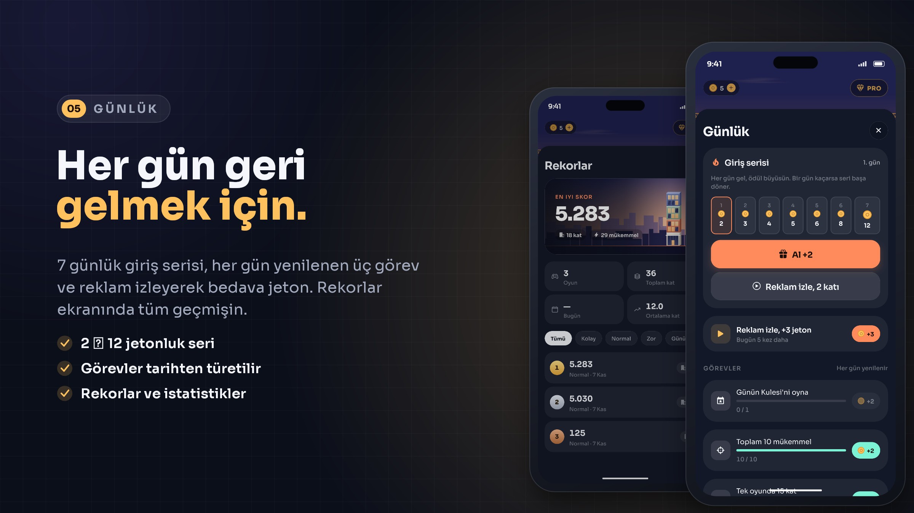</p>
<p align="center">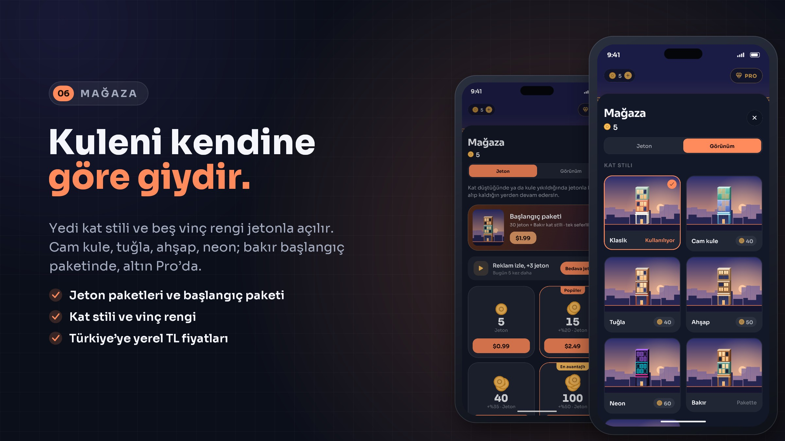</p>
<p align="center">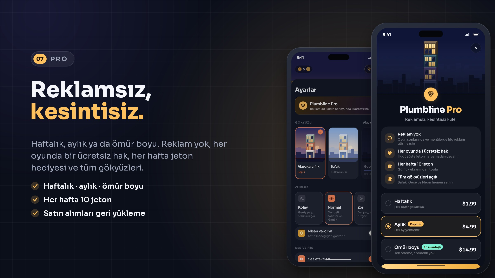</p>
<p align="center">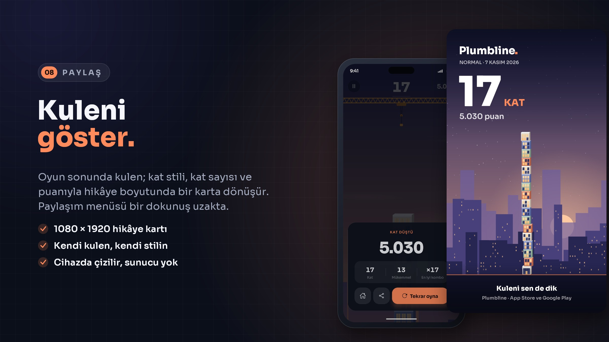</p>

<p align="center"><sub>Telefon ekranları, uygulamanın Android emülatöründen alınmış gerçek görüntüleridir. Kartlar <code>scripts/readme-art.js</code> ile çiziliyor.</sub></p>

<details>
<summary><b>Tüm özellikler</b></summary>
<br>

| Alan | Özellikler |
| :-- | :-- |
| **Oynanış** | Gerçek sarkaç · bırakınca korunan momentum · ağırlık merkezine göre devrilme ve kule bölümü yıkılması · esneyen kule · mükemmel / iyi / normal isabet ve kombo · nişan yardımı |
| **Modlar** | Sonsuz (kolay / normal / zor) · Günün Kulesi (herkes için aynı seed ve hava) · Hayalet (rekor koşusuyla yarış) |
| **Hava** | Açık · Rüzgârlı ×1,2 · Fırtına ×1,5 (esinti, yağmur, şimşek) · Sisli ×1,15 |
| **Devam** | Bedava ek hak yok; her kayıpta jetonla hak (1, 2, 3… jeton, oyun başına en fazla 5) · reklamla bir kez ücretsiz · yanlışlıkla basmaya karşı korumalı |
| **Günlük** | 7 günlük giriş serisi (2 → 12 jeton) · her gün 3 görev · reklam izleyerek jeton (günde 5) |
| **Mağaza** | 4 jeton paketi · başlangıç paketi · 7 kat stili · 5 vinç rengi · Türkiye'ye yerel TL fiyatları |
| **Plumbline Pro** | Haftalık, aylık ve ömür boyu · reklam yok · her oyunda 1 ücretsiz hak · her hafta 10 jeton · tüm gökyüzleri ve altın kat stili |
| **Paylaşım** | Oyun sonunda 1080 × 1920 kule kartı, cihazda çizilir |
| **Görünüm** | 4 gökyüzü teması (kat rekoruyla açılır) · yükseldikçe değişen gökyüzü · parallax şehir · parçacıklar · yıkılma animasyonu |
| **Erişilebilirlik** | Hareketi azalt · ekran okuyucu etiketleri · Dynamic Type · Türkçe ve İngilizce |

</details>

<br>

## Fizik

Oyun mantığı `src/engine` altında, React'ten ve çizimden tamamen bağımsız, saf TypeScript.

| Kural | Nasıl |
| :-- | :-- |
| **Sarkaç** | θ'' = (−g · sin θ + a<sub>rüzgâr</sub> · cos θ) / L. Vinç katı hep kulenin hemen üstüne indirir; ilk katlarda ip uzun, salınım yavaş. |
| **Bırakış** | Kat ip ucunun hızıyla ayrılır, yerçekimi ve yan rüzgârla parabol çizer. |
| **Devrilme** | Kat alttakinin üstüne düz oturur. Merkezi alttaki katın kenarını aşarsa kenardan devrilir. |
| **Yıkılma** | Her yerleşimde her katın üstündeki bölümün ağırlık merkezi kontrol edilir; desteği aşan bölüm kenar etrafında dönerek düşer. |
| **Esneme** | Kule sönümlü bir yay gibi salınır; sehim yükseklikle büyür. Kaçık iniş sallar, tam oturan kat sakinleştirir. |

Fizik 390 × 844'lük sanal bir alanda, 1/120 sn sabit adımla çalışır; renderer bunu cihaza ölçekler, telefon ve tablette oyun aynıdır.

Oyun **deterministiktir**: aynı seed ve aynı bırakma anları her zaman aynı skoru verir. `Math.sin` JavaScript motorları arasında son basamakta farklı sonuç verebildiği için kendi `dsin` fonksiyonu kullanılır. Bu sayede bir oyun kaydı başka bir cihazda ya da sunucuda baştan oynatılıp doğrulanabilir (`verify`); Hayalet modu da aynı mekanizmayla çalışır.

<br>

## Mimari

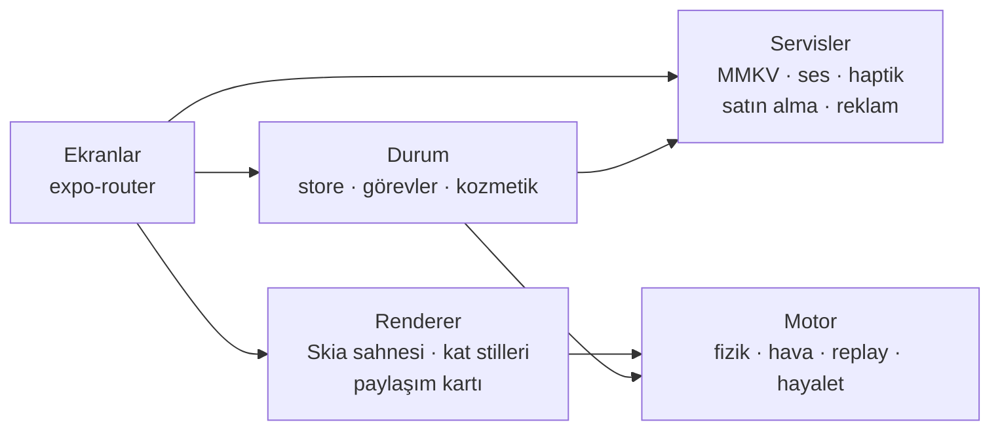

| Katman | Sorumluluk |
| :-- | :-- |
| **app/** | Ekranlar: ana menü, oyun, günlük, mağaza, Pro, rekorlar, ayarlar |
| **src/engine** | Sarkaç, düşüş, devrilme, kule esnemesi, hava, puan, replay ve hayalet. Platformdan bağımsız, birim testli |
| **src/render** | Skia sahnesi: her kare tek bir `SkPicture`; kat, silüet ve bulutlar önbellekli. Kat stilleri, önizlemeler, paylaşım kartı |
| **src/state** | Ayarlar ve ilerleme, şema doğrulaması, günlük seri, görevler, kozmetik kataloğu |
| **src/services** | Şifreli depolama, ses ve haptik, satın alma ve reklam arayüzleri, paylaşım |

<details>
<summary><b>Teknoloji yığını</b></summary>
<br>

| Alan | Teknoloji |
| :-- | :-- |
| Uygulama | Expo SDK 58, React Native 0.88 (New Architecture), TypeScript strict |
| Gezinme | expo-router |
| Çizim | @shopify/react-native-skia, react-native-reanimated |
| Depolama | react-native-mmkv (AES-256), expo-secure-store |
| Ses ve his | expo-audio, expo-haptics |
| Paylaşım | Skia offscreen yüzey, expo-file-system, expo-sharing |
| Dil | expo-localization, yerleşik TR / EN sözlükleri |
| Test | Vitest |
| Varlıklar | Ses, müzik, ikon ve README görselleri kodla üretilir (`scripts/`) |
| Derleme | EAS Build |

</details>

<details>
<summary><b>Proje yapısı</b></summary>
<br>

```text
.
├── app/                    # ekranlar (expo-router)
├── src/
│   ├── engine/             # fizik, hava, replay, hayalet + testler
│   ├── render/             # Skia sahnesi, kat stilleri, paylaşım kartı
│   ├── state/              # durum, şema, görevler, kozmetik
│   ├── services/           # depolama, ses, satın alma, reklam, paylaşım
│   ├── ui/                 # bileşenler, tasarım tokenları
│   └── i18n/               # Türkçe ve İngilizce
├── scripts/                # ses, müzik, ikon ve README görseli üreticileri
├── assets/                 # ikon, açılış, ses ve müzik
└── docs/                   # gizlilik, mağaza metinleri, gelir modeli, ekranlar
```

</details>

<br>

## Gelir modeli

Bedava ek hak yok: her kayıpta jetonla hak alınır. Jetonlar satın alınır ya da günlük seri, görevler ve reklam izleyerek kazanılır. Plumbline Pro reklamları kaldırır.

| | ABD | Türkiye |
| :-- | :-- | :-- |
| Jeton 5 / 15 / 40 / 100 | $0.99 / $2.49 / $5.99 / $12.99 | ₺24,99 / ₺59,99 / ₺139,99 / ₺299,99 |
| Başlangıç paketi | $1.99 | ₺49,99 |
| Pro haftalık / aylık / ömür boyu | $1.99 / $4.99 / $14.99 | ₺49,99 / ₺119,99 / ₺349,99 |

<br>

## Güvenlik ve gizlilik

- Hesap, sunucu, izleme yok; kişisel veri toplanmaz
- Kayıtlar MMKV'de AES-256 ile şifreli, anahtar Keychain / Keystore'da; keychain'e ulaşılamazsa veriler şifresiz diske değil yalnızca belleğe yazılır
- Diskten okunan her alan tip ve sınır kontrolünden geçer; hayalet kayıtları da doğrulanır (`src/state/schema.ts`)
- Android yedekleme kapalı (`allowBackup: false`), kayıt dosyası cihazdan çekilemez
- Günlük ödülde saat geri alınarak tekrar ödül toplanamaz
- Bağımlılıklarda `npm audit` temiz

Gizlilik politikası: [docs/privacy-policy.md](docs/privacy-policy.md)

<br>

## Test

Motorun 17 testi: sarkaç enerjisi ve periyodu, bırakılan katın momentumu, kusursuz kule, kenardan devrilme, kule bölümünün yıkılması, devam hakları, rüzgârın düşen kata etkisi, her hava olayında replay doğrulaması, hayaletin rekoru birebir tekrar etmesi ve bozuk kayıtların reddedilmesi.

<br>

## Yol haritası

- [x] Fizik tabanlı motor ve deterministik replay
- [x] Hava olayları, hayalet modu, Günün Kulesi
- [x] Günlük seri, görevler, kozmetik mağaza, paylaşım kartı
- [x] Hak satın alma, jeton paketleri, Plumbline Pro arayüzü
- [ ] Mağaza satın almaları (RevenueCat)
- [ ] AdMob (ödüllü + geçiş), UMP onayı ve iOS ATT
- [ ] iOS cihaz testi, mağaza görselleri, gizlilik politikasının yayınlanması
- [ ] v1.1: Game Center / Play Games liderlik tabloları (skorlar replay ile doğrulanır)

<br>

## Lisans

Tüm hakları saklıdır. Kod yalnızca incelenmek üzere yayımlanmıştır; izin olmadan kullanılamaz, kopyalanamaz ya da yayımlanamaz. Ayrıntılar: [LICENSE](LICENSE)
